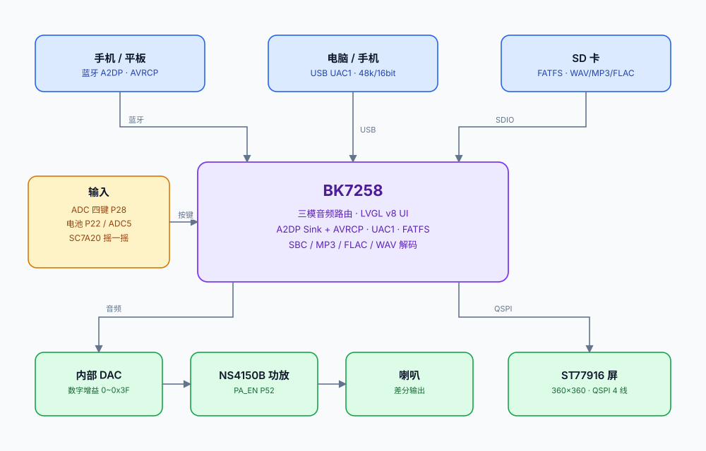

<div align="center">

# 基于 BK7258 的蓝牙音箱

**板级自检程序 · 三模音箱**

`BK7258` · `LVGL v8` · `蓝牙 A2DP` · `USB UAC1` · `FATFS` · `MIT`

</div>

---

## 一、仓库内容

本仓库是 **BK7258（8MB Flash / 16MB PSRAM）** 开发板的两个可编译工程：

| 工程 | 用途 | 适合 |
| --- | --- | --- |
| **[app_test_program](app_test_program/)** | 串口命令行**板级自检**：电源、GPIO、I2C、屏、电池、摄像头、MIC、SD、USB、音频 | 刚拿到板子，先跑它确认硬件 |
| **[app_bk_soundbox](app_bk_soundbox/)** | **三模音箱**：蓝牙 / USB 声卡 / SD 播放器 / USB 麦克风，LVGL 圆形屏 UI | 整机演示、做产品 |

> 两个工程目录下都放了预编译 `all-app.bin`（文件名 `没有环境烧录这个all-app.bin`），没有编译环境也能直接烧。

## 二、硬件

| 外设 | 说明 |
| --- | --- |
| 主控 | BK7258（8MB Flash / 16MB PSRAM） |
| 屏幕 | ST77916 **360×360 圆形 QSPI 4 线**（P2=CLK P3=CSN P4~P7=IO0~3），背光 P23，屏电源 P51 |
| 按键 | **4 颗 ADC 按键**，P28/ADC4（无触摸） |
| SD 卡 | SDIO 4 线 P14~P19，卡检测 P40（低有效） |
| 音频 | 内部 DAC → NS4150B 差分功放 → 喇叭，PA_EN P52 |
| 电池 | P22/ADC5，1:3 分压（R21 220k / R24 110k） |
| USB | 芯片专用 DP/DM，UAC1 声卡（+ CDC 串口） |
| 串口 | **Shell：UART1 TX=P0 RX=P1，115200 8N1**；日志：UART0 TX=P11 RX=P10 |

## 三、准备 SDK 并导入工程

两个工程都基于 **Beken Armino SDK（bk_avdk_smp）**，且要求放在 SDK 的 **`projects/`** 目录下（工程 Makefile 默认 `SDK_DIR = ../..`）。

```bash
# 1. 准备 bk_avdk_smp
git clone -b release/v3.1.1 https://github.com/bekencorp/bk_avdk_smp.git bk_avdk_smp 

# 2. 克隆本项目（放在任意位置）
# 对于调试例程，需要安装 CherrySH 模块
git clone --recursive https://github.com/dggduu/project_bk7258_soundbox_example.git bk7258-firmware

# 3. 把两个工程导入 SDK 的 projects/
cp -r bk7258-firmware/app_test_program  bk_avdk_smp/projects/
cp -r bk7258-firmware/app_bk_soundbox   bk_avdk_smp/projects/
```

导入后目录关系必须是：

```
bk_avdk_smp/
├── tools/  ap/  cp/  ...
└── projects/
    ├── app_test_program/     ← 工程根（Makefile / CMakeLists.txt 在这一层）
    └── app_bk_soundbox/
```

> 不想拷贝也可以：工程放在任何位置，编译时显式指定 SDK 路径即可
> `make bk7258 SDK_DIR=/path/to/bk_avdk_smp`。

## 四、编译、烧录、连串口

```bash
cd bk_avdk_smp/projects/app_test_program   # 或 app_bk_soundbox
make bk7258

# 固件
build/bk7258/<工程名>/package/all-app.bin
```

用 **BK 官方烧录工具** 或者 [lckfb 在线烧录工具](https://wiki.lckfb.com/storage/html/bk7258-web-flasher/#/download) 烧 all-app.bin（也可直接烧仓库里的预编译 bin）。

连 **UART1（P0/P1，115200 8N1）**，上电看到 `cherrysh ready ...` 后输入 `help`。

## 五、板级自检：app_test_program

**拿到新板按下面顺序跑一遍**，哪一步失败就重点查对应硬件：

| # | 命令 | 检查 |
| :-: | --- | --- |
| 1 | `board` | 板子信息、串口与电源使能脚 |
| 2 | `ldo` | 各路电源状态（屏 / 摄像头 / 1V8 / 2V8 / PA…） |
| 3 | `i2c scan 0` / `i2c scan 1` | I2C 扫描（0=摄像头，1=触摸/加速度计） |
| 4 | `accel` | SC7A20 加速度计读一次 XYZ |
| 5 | `lcdq init` → `lcdq bars` → `lcdq fill 0xF800` | 屏：初始化 / 彩条 / 纯色 |
| 6 | `bat` | 电池电压、百分比、raw |
| 7 | `sd` → `sd list` → `sd speed` | SD 卡初始化 / FATFS / 读速 |
| 8 | `music play 1:/test.wav` | DAC / 功放 / 喇叭 |
| 9 | `dmic` / `dmic diag` | 数字 MIC 采集与诊断 |
| 10 | `usb` | USB CDC 虚拟串口 |
| 11 | `ov3660 probe` → `camera show` | 摄像头 PID / MCLK / DVP 出图 |

### 常用命令

| 命令 | 作用 | 示例 |
| --- | --- | --- |
| `help` | 列出全部命令 | `help` |
| `board` | 板级信息 | `board` |
| `ldo [name] [on\|off\|toggle]` | 电源轨控制 | `ldo src on` / `ldo all off` |
| `i2c [scan\|bb\|read]` | 总线扫描、bit-bang、读寄存器 | `i2c scan 0` / `i2c read 1 0x18 0x0F 1` |
| `accel [poll\|reg]` | SC7A20 加速度计 | `accel poll 5` |
| `lcdq init [boe\|esp32\|sdk]` | 屏初始化（切换初始化表） | `lcdq init boe` |
| `lcdq bars` / `lcdq fill <color>` | 彩条 / 纯色 | `lcdq fill 0xF800` |
| `lcdq bl on\|off` / `lcdq power on\|off` | 背光 / 屏电源 | `lcdq bl on` |
| `lcdq clk [MHz]` | QSPI 时钟（信号差时降到 40/32…） | `lcdq clk 40` |
| `bat [raw\|cal <mv>]` | 电池 ADC、校准 | `bat` / `bat raw` |
| `ov3660 probe` | 上电 + MCLK + 读 PID | `ov3660 probe` |
| `ov3660 read/write <reg>` | 寄存器读写（写会回读校验） | `ov3660 write 0x503D 0x80` |
| `camera show` | 采一帧 → 360×360 显示 | `camera show` |
| `camera save` / `camera raw` | 存 BMP / 原始 YUYV 到 SD | `camera raw 1:/cam.yuv` |
| `camera dump` | 打印帧元数据 + 字节，查 DVP 是否写入 | `camera dump` |
| `dmic [ms]` / `dmic diag` | MIC 采集 / 一键自检 | `dmic 200` |
| `sd` / `sd list` / `sd speed` | SD 卡初始化 / 挂载目录 / 测速 | `sd list` |
| `music play <file>` / `music vol` | 播放测试 / 音量 | `music play 1:/a.mp3` |
| `usb` / `usb send <text>` | USB CDC 状态 / 发数据 | `usb send hi` |

### 常见问题定位

- **屏不亮 / 花屏**：`lcdq` 看状态 → `lcdq power on` → `lcdq bl on` → `lcdq init` → `lcdq bars`；信号差的板子把 `lcdq clk 16` 降频再试。
- **摄像头不出图**：`ov3660 probe` 能读到 PID 说明 SCCB 正常；再 `camera detect`、`camera show`；仍 0 帧用 `camera dump` 看帧里有没有数据。
- **电池显示 `--%`**：`bat raw` 看 raw 是否饱和/漂移；`bat cal <实测 mV>` 可现场校准。
- **SD 卡不识别**：`sd` 看初始化，`sd dbg` 看 P14~P19 的 GPIO 复用是否正确。
- **MIC 没数据**：`dmic diag` 一把梭，逐项打印电源域 / AUD / GPIO / FIFO / 时钟。

> 测试程序以**只读调试**为主：`sd w`、`gpio` 输出、`lcdq cmd` 等会改动硬件/数据，按需使用。

## 六、三模音箱：app_bk_soundbox



**4 种模式**（<kbd>KEY4</kbd> 长按循环）：

| 模式 | 用法 |
| --- | --- |
| **蓝牙** | 手机搜索 `bk7258_soundbox` 配对，A2DP 放歌 + AVRCP 控制 + 手机端音量 |
| **USB** | Type-C 连电脑/手机，UAC1 声卡 48kHz/16bit 立体声 |
| **SD 卡** | 播放 WAV / MP3 / FLAC，支持同名 `.lrc` 歌词、`.bmp` 封面、ID3/Vorbis 标签 |
| **USB 麦** | 本机当 USB 麦克风，电脑录音 |

**按键**（短按 / 长按连发）：

| 按键 | 短按 | 长按 |
| --- | --- | --- |
| <kbd>KEY1</kbd> | 播放页快退 10s；其它页上移 | 上一首；其它页音量 − |
| <kbd>KEY2</kbd> | 播放/暂停；文件页打开；模式页切换；设置页调整 | 播放页摇一摇开关；其它页蓝牙配对 |
| <kbd>KEY3</kbd> | 播放页快进 10s；其它页下移 | 下一首；其它页音量 + |
| <kbd>KEY4</kbd> | 切换页面：播放 → 文件 → 模式 → 设置 | 切换模式 |

**SD 卡布局**：

```
1:/
├── music/
│   ├── song.mp3 / song.flac / song.wav
│   ├── song.lrc      # 可选：同名歌词（UTF-8 / GB2312）
│   └── song.bmp      # 可选：同名封面
├── cover.bmp         # 目录兜底封面
└── folder.bmp
```

**电量与省电**：P22/ADC5 1:3 分压，SDK 出厂标定换算，5s 采样 + EMA；状态栏 `VOL 60 88%` + 电池图标；无操作 60s 熄背光，拿起（SC7A20 运动中断）自动亮屏。

## 七、目录结构

```
share/
├── app_test_program/            # 板级自检（Shell 命令）
│   ├── ap/                      # cmd_*.c：ldo/gpio/i2c/lcdq/bat/ov3660/camera/dmic/sd/music/usb
│   ├── bsp/                     # 电源/ADC/屏/音频/SD/摄像头 BSP
├── app_bk_soundbox/             # 三模音箱
│   ├── ap/app/                  # 模式/UI/蓝牙/音频/配置/传感器
│   ├── bsp/                     # 屏/LVGL/按键/电池/SD/音频
├── docs/                        # 架构图（system.drawio / system.svg）
└── README.md
```

## 八、说明

- 工程依赖 **bk_avdk_smp**（Beken Armino SDK），请按上文放进 `projects/` 或编译时用 `SDK_DIR=` 指定路径。
- 如果没有编译环境，项目中有预编译 BIN。
- 本板子信号完整性较差，如果在调试时遇到通讯问题，请先检查是否虚焊，然后尝试降低通讯速度。

## License

**MIT** — 可自由使用、修改、分发，保留版权与许可声明即可。
